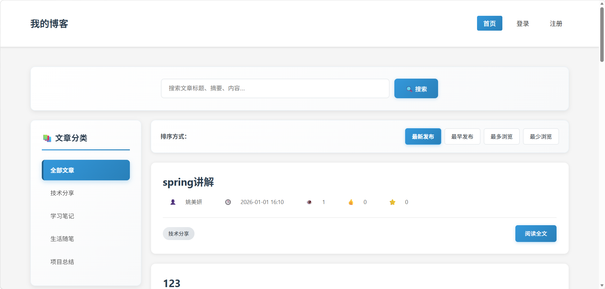
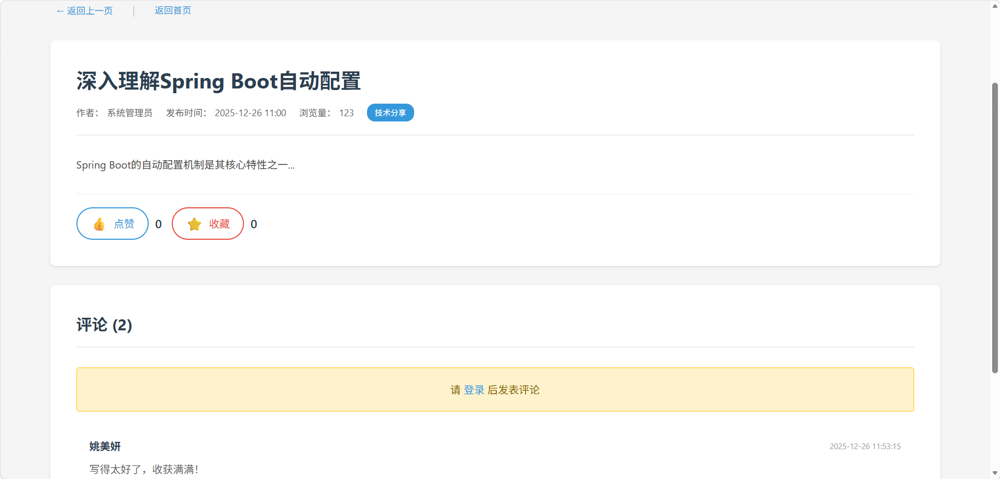
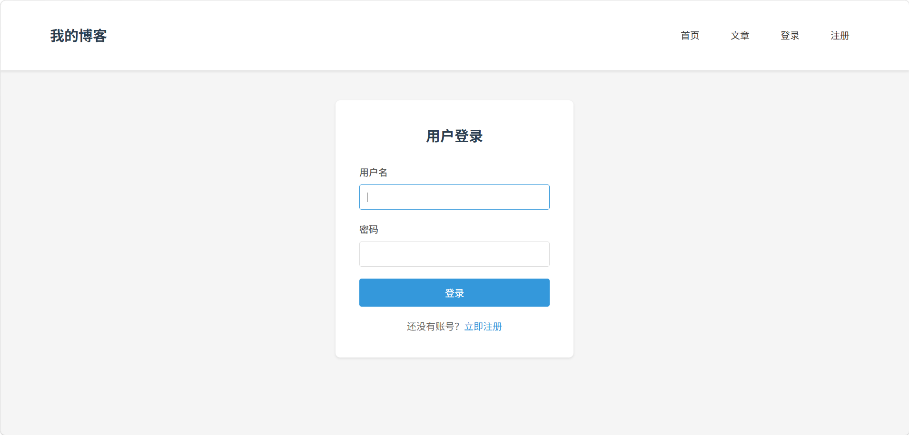
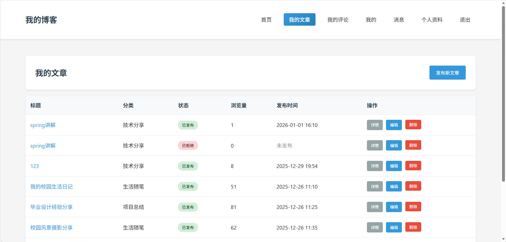
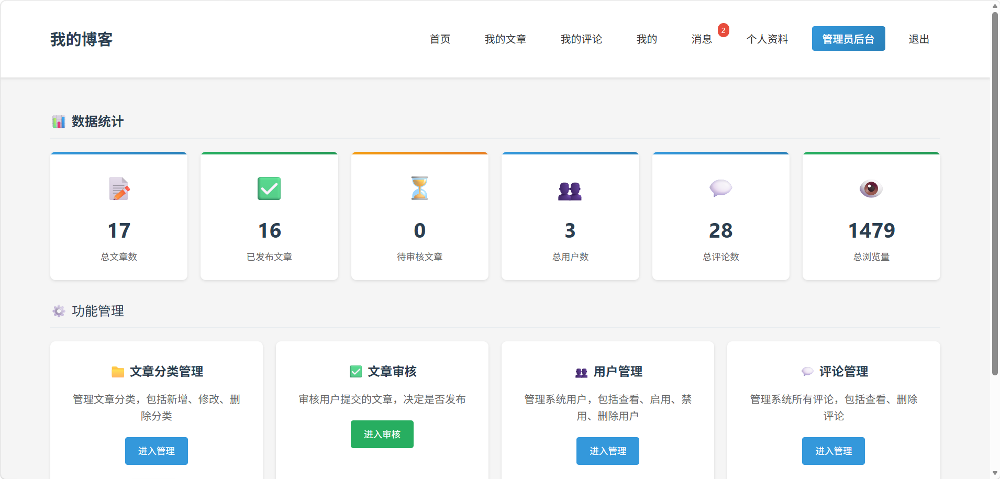

# Blog - 个人博客系统

基于 Spring Boot 3 开发的个人博客系统，支持文章发布审核、评论、点赞、收藏、消息通知等功能。

## 界面预览

### 首页



### 文章详情



### 用户登录



### 用户中心



### 管理后台



## 技术栈

| 技术            | 版本  | 说明     |
| --------------- | ----- | -------- |
| Java            | 17    | 编程语言 |
| Spring Boot     | 3.5.6 | 应用框架 |
| Spring Security | 6     | 安全框架 |
| MyBatis-Plus    | 3.5.5 | ORM 框架 |
| MySQL           | 8.0   | 数据库   |
| Thymeleaf       | -     | 模板引擎 |
| Lombok          | -     | 代码简化 |

## 功能特点

### 用户模块

- 用户注册与登录
- 角色权限控制（管理员 / 普通用户）
- 个人信息管理（头像、昵称、邮箱等）

### 文章模块

- 文章发布、编辑、删除
- 文章分类管理（技术分享、学习笔记、生活随笔、项目总结）
- 文章审核机制（待审核 → 已发布 / 已拒绝）
- 浏览量统计

### 互动功能

- 评论与回复（支持嵌套评论）
- 文章点赞
- 文章收藏

### 消息通知

- 点赞/收藏自动通知文章作者
- 已读/未读状态管理

### 后台管理

- 用户管理（查看、禁用）
- 文章审核
- 分类管理
- 评论管理
- 数据统计

## 项目结构

```
blog/
├── src/main/java/com/cg/
│   ├── config/          # 配置类
│   ├── controller/     # 控制器层
│   │   ├── admin/      # 后台管理
│   │   ├── front/      # 前台页面
│   │   └── user/       # 用户中心
│   ├── dto/            # 数据传输对象
│   ├── entity/         # 实体类
│   ├── mapper/         # 数据访问层
│   ├── security/       # 安全认证
│   ├── service/        # 业务逻辑层
│   └── util/           # 工具类
├── src/main/resources/
│   ├── templates/      # Thymeleaf 模板
│   │   ├── admin/      # 后台模板
│   │   ├── front/      # 前台模板
│   │   └── user/       # 用户模板
│   ├── sql/            # 数据库脚本
│   │   └── forgot-password.sql  # 密码重置表（已合并到blog_db.sql）
│   ├── application.yml # 应用配置
│   └── blog_db.sql     # 数据库完整脚本（含所有表结构和测试数据）
├── screenshots/        # 项目截图
└── pom.xml             # Maven 配置
```

## 数据库初始化

本项目使用 MySQL 数据库，需要手动创建数据库并导入初始数据。

### 步骤 1：创建数据库

```sql
CREATE DATABASE blog_db DEFAULT CHARACTER SET utf8mb4 COLLATE utf8mb4_unicode_ci;
```

### 步骤 2：导入数据库脚本

将 `src/main/resources/blog_db.sql` 文件导入到数据库中：

**Windows (PowerShell):**

```powershell
mysql -u root -p blog_db < src\main\resources\blog_db.sql
```

**Mac/Linux:**

```bash
mysql -u root -p blog_db < src/main/resources/blog_db.sql
```

该脚本包含：

- 所有表结构（用户、文章、评论、点赞、收藏、通知、密码重置令牌等）
- 测试数据（分类、文章、评论、用户等）

## 快速开始

### 环境要求

| 软件  | 版本要求 | 下载地址                         |
| ----- | -------- | -------------------------------- |
| JDK   | 17+      | https://adoptium.net/            |
| Maven | 3.6+     | https://maven.apache.org/        |
| MySQL | 8.0+     | https://dev.mysql.com/downloads/ |

### 完整运行步骤

1. **克隆项目**

```bash
git clone https://github.com/BAIXIYAN/blog-demo.git
cd blog-demo
```

2. **配置数据库连接**

编辑 `src/main/resources/application.yml`，修改数据库用户名和密码：

```yaml
spring:
  datasource:
    url: jdbc:mysql://localhost:3306/blog_db?useUnicode=true&characterEncoding=utf-8&serverTimezone=Asia/Shanghai
    username: root # 修改为你的 MySQL 用户名
    password: 123456 # 修改为你的 MySQL 密码
```

3. **创建数据库并导入数据**

```bash
# 登录 MySQL
mysql -u root -p

# 在 MySQL 命令行中执行
CREATE DATABASE blog_db DEFAULT CHARACTER SET utf8mb4 COLLATE utf8mb4_unicode_ci;
EXIT;

# 导入数据
mysql -u root -p blog_db < src/main/resources/blog_db.sql
```

4. **编译项目**

```bash
mvn clean compile
```

5. **运行项目**

```bash
mvn spring-boot:run
```

6. **访问应用**

启动成功后，打开浏览器访问：

- 🏠 前台首页：http://localhost:8080/
- 🔑 用户登录：http://localhost:8080/user/login
- 📝 用户注册：http://localhost:8080/user/register
- 🔄 忘记密码：http://localhost:8080/password/forgot
- ⚙️ 管理后台：http://localhost:8080/admin/

### 默认测试账号

| 角色     | 用户名   | 密码     | 说明                     |
| -------- | -------- | -------- | ------------------------ |
| 管理员   | admin    | admin123 | 可以管理用户、审核文章等 |
| 普通用户 | 自行注册 | -        | 访问注册页面创建账号     |

### 常见问题

**Q: 启动报数据库连接错误？**
A: 请检查 MySQL 是否已启动，用户名密码是否正确，数据库 `blog_db` 是否已创建。

**Q: 忘记密码功能报错？**
A: 请确认已执行最新的 `blog_db.sql`，该文件已包含 `password_reset_token` 表。

**Q: 端口被占用？**
A: 修改 `application.yml` 中的 `server.port` 为其他端口（如 8081）。

## 许可协议

MIT License
